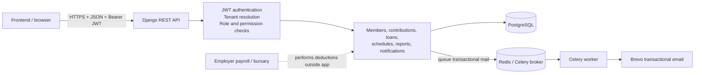
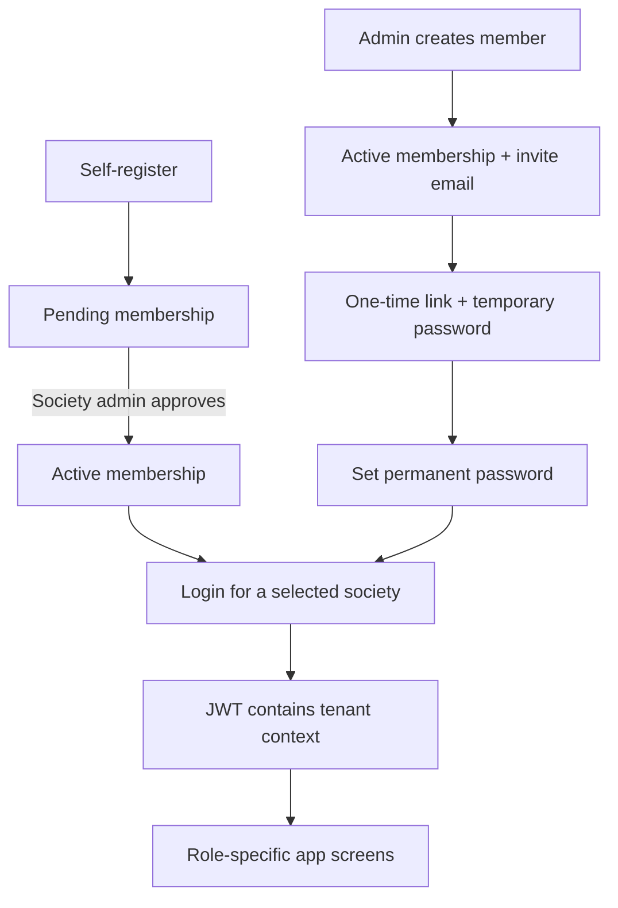
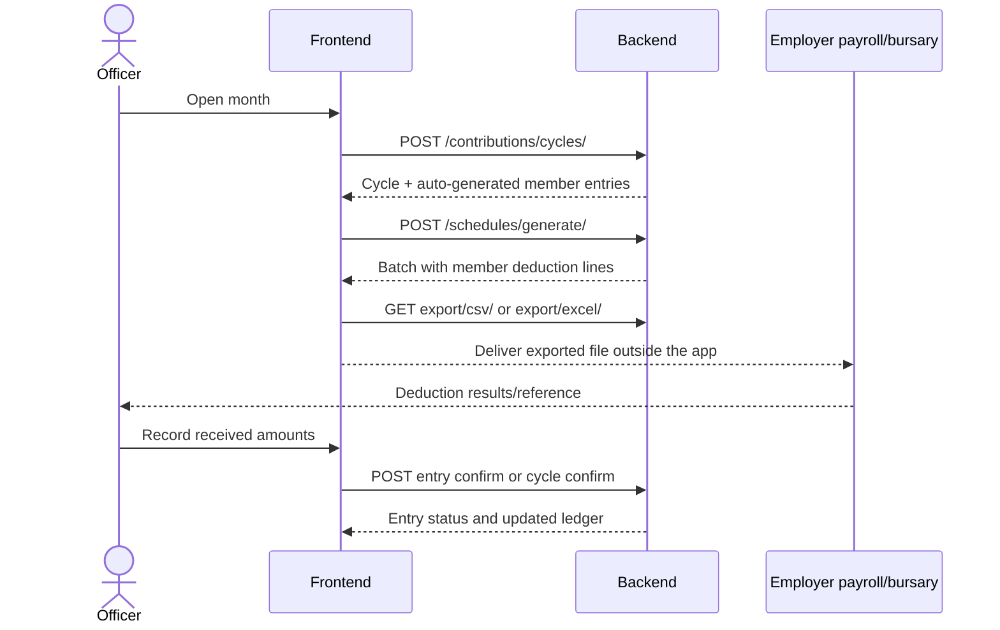

# Frontend Integration Guide

This guide describes the backend as it exists today and gives a frontend developer a route map, role model, and the main user journeys to build against. It is based on the Django code in this repository. The generated OpenAPI document is the source of truth for exact request and response schemas.

## 1. What this application is

This repository is a multi-tenant Django REST API for cooperative societies. It is designed for societies where the employer's payroll or bursary office deducts contributions and loan repayments. The application records those deductions, manages member and loan workflows, and prepares schedules for the payroll office. It does not collect payments or transfer loan money.

There is no member-facing frontend in this repository. A browser pointed at `/` is redirected to the Swagger API browser; that page is developer documentation, not the cooperative portal.

## 2. Local environment and API documentation

With the local Compose stack running:

| URL | Purpose |
| --- | --- |
| `http://localhost:8000/` | Redirects to Swagger UI |
| `http://localhost:8000/api/docs/` | Interactive API reference |
| `http://localhost:8000/api/redoc/` | ReDoc API reference |
| `http://localhost:8000/api/schema/` | OpenAPI JSON schema |
| `http://localhost:8000/health/ready/` | Readiness check, including database |

Routes in this guide are relative to `http://localhost:8000`. All application APIs are under `/api/v1/`.

The local database is not populated by migrations. Run `docker compose exec web python manage.py seed_demo` to create the demo society and accounts. The command's output and `README.md` list the demo logins. Do not expect member, role, or product lists to have data before seeding or creating it.

## 3. System design



The core data model is:

- `UserAccount` is a global email/password identity.
- `Membership` joins a user to one cooperative (`Tenant`), with a tenant role and a membership status. One user can belong to multiple cooperatives.
- `MemberProfile` holds society-specific employment/payroll data. A user may have a different profile in each society.
- Contribution plans, cycles, entries, loans, schedules, notifications, and ledger rows are tenant-scoped. The server filters them by the tenant on the authenticated request.
- Compulsory contributions, share capital, and loan balances are distinct concepts. Share capital is kept in its own share register and is not added to the contribution ledger.
- `FinancialLedger` is append-only history. Corrections should be represented by new financial events/adjustments, not by editing past rows.



## 4. Request conventions

### Authentication and tenant context

After login, send the access token on protected requests:

```http
Authorization: Bearer <access-token>
Content-Type: application/json
```

The access token carries a signed tenant claim. The frontend normally does **not** need to send an `X-Tenant-ID` header. A user with one active membership may omit `tenant_code` at login; a user with multiple active memberships must specify which society to enter. Use the returned `tenant` and `role` for the active app context, then call `/api/v1/auth/me/` to fetch the user's current profile and memberships.

Platform administrators are the exception: their login is platform-scoped and uses `/api/v1/platform/`; they do not select a cooperative at login.

Access tokens last 30 minutes by default; refresh tokens last 7 days and rotate when refreshed. Refresh through `POST /api/v1/auth/refresh/`. Logout through `POST /api/v1/auth/logout/` with the refresh token.

### JSON, money, pagination, and errors

- IDs are UUIDs. Treat monetary values as decimal strings; do not convert them to JavaScript floating-point values for calculations. Use the quote response for repayment amounts.
- Standard paginated lists return `count`, `next`, `previous`, and `results`. Default page size is 25. Use `?page=` and `?page_size=`; maximum page size is 100 for the standard paginator. Some large/small endpoints may use a different configured paginator.
- Common responses: `401` means missing/expired/invalid authentication; `403` means authenticated but unauthorized; `404` means missing or outside the current tenant; `400` contains validation/business-rule errors. Show field-level validation errors from the response instead of replacing them with a generic failure.
- Do not treat client-side role checks as security. The backend enforces tenant membership and permissions on every protected route.

## 5. Roles and frontend capabilities

The backend roles are `MEMBER`, `COMMITTEE_MEMBER`, `EXECUTIVE`, `SOCIETY_ADMIN`, and platform-level `SUPER_ADMIN`.

| Role | Frontend areas/actions generally available |
| --- | --- |
| `MEMBER` | Own contribution history/balance, own notifications, member directory, own share register and dividend entitlements, share subscription, exit request, loan quote/eligibility/application, applications where they are applicant or guarantor, confirm/decline own guarantee requests, read loan products and active loans filtered to self. |
| `COMMITTEE_MEMBER` | Read-only financial cycles/entries/penalties, ledger, reports, loan applications, loan products, directory, and own notifications. No schedule generation or financial writes. |
| `EXECUTIVE` | Financial operations, contribution confirmation, share payment recording, dividend payment-status recording, schedules and exports, review/approve/reject loan applications, reports, loan/product reads. Cannot manage members or edit society configuration. |
| `SOCIETY_ADMIN` | Executive capabilities plus member management, roles, contribution plans and agreements, share/dividend product configuration and declaration approval, loan product configuration, and its own society branding/settings/rules. |
| `SUPER_ADMIN` | Platform-wide tenant listing/creation/lifecycle management and platform statistics. |

There are both role-code and permission-code checks. A per-user allow/deny override can affect permission-gated actions. There is no `/me/capabilities` endpoint; build the navigation from the active role, and still handle `403` responses. The role/permission catalog is readable at `/api/v1/members/roles/` and `/api/v1/members/permissions/` for metadata.

Member directory responses are intentionally restricted: ordinary members see name/email/role, while `SOCIETY_ADMIN` can see the full profile, which may include payroll numbers, date of birth, next-of-kin, and bank details. Only request/render profile details on the admin or the member's own profile screen.

## 6. User journeys and screens

### A. Sign in and choose society

`POST /api/v1/auth/login/`

```json
{
  "email": "member@example.com",
  "password": "<password>",
  "tenant_code": "acada"
}
```

Successful response includes `access`, `refresh`, `tenant: {id, code, name}`, `role`, and `user`. Omit `tenant_code` only when the account has exactly one active membership. The response explains errors such as no active membership or multiple memberships without a society choice.

Then:

1. Keep the access token for API calls and the refresh token for renewal/logout.
2. Call `GET /api/v1/auth/me/` for user data and all active memberships.
3. Load the app shell for the returned active role and tenant.

Other auth routes:

| Method and route | Use |
| --- | --- |
| `POST /api/v1/auth/register/` | Self-registration; body has `email`, `first_name`, `last_name`, `phone`, `password`, `password_confirm`, optional `tenant_code`. |
| `POST /api/v1/auth/refresh/` | Rotate/refresh access token with `{ "refresh": "..." }`. |
| `POST /api/v1/auth/logout/` | Blacklist refresh token with `{ "refresh": "..." }`. |
| `POST /api/v1/auth/password/change/` | Authenticated password change; requires `old_password`, `new_password`, `new_password_confirm`. |
| `GET /api/v1/auth/me/` | Current account and active memberships. |

Self-registration creates a `PENDING` membership when the supplied society code is valid. If `tenant_code` is omitted, it creates only the account; the person has no society membership and cannot sign in to tenant endpoints. A pending member cannot sign in until a society admin activates the membership. The registration serializer silently ignores an invalid society code, so the UI should validate/show the selected society before submitting and not assume membership creation succeeded from the 201 response alone.

Self-registration creates a user and membership, but does **not** create a `MemberProfile`. After approval, the member needs to complete the tenant profile through `/api/v1/members/{membership_id}/profile/`; the first `GET` creates a blank profile if missing. Capture the employment/payroll fields there before showing contribution/loan workflows, because those workflows return `Member profile not found` without one.

### B. Admin adds or approves a member

Society admin member screens use:

| Method and route | Use |
| --- | --- |
| `GET /api/v1/members/` | Directory/full roster, with `?search=`, `?status=`, `?role__code=`, ordering and pagination. |
| `POST /api/v1/members/` | Admin-initiated member creation. |
| `GET /api/v1/members/pending/` | Pending membership queue. |
| `PATCH /api/v1/members/{membership_id}/status/` | Approve, suspend, or remove membership; body contains `status` and optional `reason`. |
| `PUT /api/v1/members/{membership_id}/role/` | Change role; body `{ "role_code": "EXECUTIVE" }` (must be a tenant role). |
| `GET/PUT/PATCH /api/v1/members/{membership_id}/profile/` | Get/update tenant-specific profile. Members may access only their own profile; society admin can manage any. |
| `GET /api/v1/members/guarantor-candidates/` | Minimal candidate rows: `id`, `full_name`, `email`, `profile_id`. |

Admin create accepts `email`, `first_name`, `last_name`, optional `phone`, `role_code`, `employee_no`, `payroll_no`, `department`, `faculty`, and `designation`. A newly created account gets an active membership and an invitation email with a temporary password and one-time password-setup link. It cannot sign in until it submits the temporary password and sets a permanent one through that link. Existing global accounts get a membership in the new society and do not receive a new-account temporary password.

### C. Member home and financial history

Useful member endpoints:

| Method and route | Use |
| --- | --- |
| `GET /api/v1/contributions/my/` | Current member's contribution entries, newest cycle first. |
| `GET /api/v1/contributions/my/balance/` | Includes `current_balance` from the combined financial ledger and `compulsory_balance` from compulsory contribution entries, plus cycle totals and counts. Do not treat the combined ledger as withdrawable savings. |
| `GET /api/v1/contributions/ledger/` | Society-level read-only ledger; requires `view_financials`, optionally `?member_profile_id=`. |
| `GET /api/v1/loans/active/` | Active loan contracts and repayment schedule; member results are self-filtered. |
| `GET /api/v1/notifications/` | Current tenant user's own in-app notifications. |
| `POST /api/v1/notifications/{id}/read/` | Mark one read. |
| `POST /api/v1/notifications/read-all/` | Mark all current user's notifications read. |

### D. Society setup and configuration

`SOCIETY_ADMIN` configures contribution plans at `/api/v1/contributions/plans/`, share products at `/api/v1/contributions/shares/products/`, and loan products at `/api/v1/loans/products/`. Members and officers can read products/plans; product and plan configuration is society-admin only. Executive/admin can record share subscriptions and payments.

Loan product fields include `name`, `description`, required product-specific `min_membership_months`, `min_contribution_months`, `guarantor_required_count`, optional `min_amount`, `max_amount` (optional cap), `max_multiplier`, `interest_rate`, required `rate_period` (`annual`, `monthly`, or `term`), `interest_method` (`flat` or `reducing`), `contribution_base`, optional `contribution_lookback_months`, optional contribution count/percentage thresholds, `required_share_units`, `min_term_months`, `max_term_months`, `auto_approval_threshold`, and `is_active`. No policy values such as a 6-month wait, 2x multiplier, 5% rate, or 12-month term are silently applied when creating a new loan product.

Contribution plans advance `policy_version` when edited, and each generated entry stores its amount, agreement reference, policy version, and rule snapshot. Loan product terms can be versioned by creating a product with `previous_version` set to the active product ID; the previous version is deactivated for new applications. Once a product has applications, changing its terms through the API is blocked. Each submitted application keeps a product terms snapshot, and the resulting loan stores the calculation and repayment quote snapshot used to approve it.

Society-wide settings are under `/api/v1/platform/tenants/{tenant_id}/`:

- `GET/PUT/PATCH branding/` for logo URL and brand colors/name.
- `GET/PUT/PATCH settings/` for currency, timezone, locale, fiscal-year start, and notification-policy JSON.
- `GET rules/` and `POST rules/` to read/publish versioned business rules. Loan keys include `default_interest_rate`, `default_interest_method`, `max_term_months`, and `escalation_threshold`; penalty keys include missed-payment flat/rate.

The society admin can access these settings only for its own tenant. Tenant list/create/stats/activate/suspend/deactivate are platform-admin operations. Creating a tenant does not by itself create its first society admin, roles, or members; bootstrapping data is a separate setup step. Although `notification_policy` is stored in tenant settings, the current dispatcher does not consult it: event emails are sent according to the notification service's configured channels.

### E. Monthly contribution and payroll flow



Cycle endpoints:

- `GET/POST /api/v1/contributions/cycles/`: create/list cycles. Creating a cycle generates pending regular entries for active memberships with active employment profiles, using the tenant's active default contribution plan.
- `GET /api/v1/contributions/cycles/{id}/entries/?status=pending`: cycle entries (requires `view_financials`).
- `POST /api/v1/contributions/cycles/{id}/confirm/`: bulk confirm pending entries. Optional body: `{ "entries": [{"member_profile_id": "<uuid>", "amount_received": "10000.00"}] }`; if omitted, pending entries are confirmed at their full due amounts. The cycle is then closed.
- `GET /api/v1/contributions/cycles/{id}/penalties/`: read penalties for the cycle (requires financial read access).
- `POST /api/v1/contributions/entries/{id}/confirm/`: confirm one entry with `{ "amount_received": "0.00", "source_reference": "optional payroll reference" }`. Full amount -> `confirmed`, positive partial amount -> `partial`, zero -> `missed`. Confirmed receipts update the member ledger.

Cycle states are `open`, `processing`, and `closed`; entry states are `pending`, `confirmed`, `missed`, and `partial`. Important: the bulk confirm endpoint confirms only pending entries, and when an `entries` list is supplied, entries omitted from the list default to their full due amount. To record zero/missed amounts explicitly, use the single-entry confirmation route. There is currently no dedicated frontend API for applying/waiving a penalty; the penalties endpoint is read-only.

Plans are records with effective dates. A cycle only auto-generates entries when an active default plan exists. Display the returned cycle `entry_count`, `confirmed_count`, and `period_display`; do not assume entry generation succeeded just because a cycle exists.

### F. Loan application and guarantor flow

The frontend should call the backend for the eligibility result and quote instead of duplicating loan math.

1. Load `GET /api/v1/loans/products/` and active member candidates from `/api/v1/members/guarantor-candidates/`.
2. Call `GET /api/v1/loans/products/{id}/eligibility/?amount=250000.00&term_months=12` as the user changes product/amount/term. The existing `POST /api/v1/loans/eligibility/` endpoint remains available with this body:

```json
{
  "loan_product_id": "<product-uuid>",
  "amount": "250000.00",
  "term_months": 12
}
```

The result contains `eligible`, `max_borrowable`, `approval_mode`, `approval_threshold`, `blocked_on_guarantors`, a message and per-rule results. When term is supplied, it also includes a repayment `quote`.

3. Optionally call `POST /api/v1/loans/products/{id}/estimate/` with `amount` and `term_months` (or the existing `POST /api/v1/loans/quote/` with `loan_product_id`) to show total interest, total repayable, monthly installment, method/rate, and the complete installment schedule. Methods are `flat` (interest on original principal) and `reducing` (interest on outstanding principal). Amounts are returned as strings; final installment absorbs rounding residue.
4. Submit `POST /api/v1/loans/applications/`:

```json
{
  "loan_product": "<product-uuid>",
  "amount_requested": "250000.00",
  "purpose": "School fees",
  "term_months": 12,
  "guarantor_member_ids": ["<member-profile-uuid>", "<member-profile-uuid>"]
}
```

`guarantor_member_ids` are **MemberProfile IDs**, which is why the candidates endpoint returns `profile_id`. The response is the full created application, including `status`, `rule_evaluation`, guarantors, and approval steps.

5. Each guarantor opens `/api/v1/loans/applications/guarantor-requests/` or the restricted `/applications/{id}/guarantee-request/`, then posts `/applications/{id}/confirm-guarantor/` with `{ "decision": "confirm" }` or `{ "decision": "decline", "reason": "..." }`.
6. If the guarantor check is the **only** failed rule, the application stays `guarantor_pending`; this is not a rejection. Once all pending guarantors respond, the backend re-evaluates. Other failed rules reject the application. Amounts above the effective approval threshold are escalated for officers.
7. Officers post `/applications/{id}/approve/` with `{ "decision": "approve", "comments": "..." }` or `{ "decision": "reject", "reason": "...", "comments": "..." }`.

Eligibility checks require sufficient membership duration, consecutive fully paid compulsory contribution periods, any configured paid-period threshold, any required paid share units, no defaulted loan, amount within the product ceiling, and valid active guarantors when required. The maximum is the configured multiplier times qualifying compulsory contributions, optionally limited by `max_amount`; a product can restrict that base to a configured look-back window. It does not use the combined financial ledger balance. Product term limits are further capped by the society rule set. Active loans alone are not an automatic block; defaulted loans are. Loan creation stores a calculation snapshot with the effective base, multiplier, rate settings, term, and quote.

Loan product configuration now includes `rate_period` (`annual`, `monthly`, or `term`), `contribution_base` (`all_time` or `lookback`), `contribution_lookback_months`, optional consistency thresholds, and `required_share_units`. Set all policy values when creating a product; the backend no longer supplies numeric eligibility, multiplier, rate, or term defaults. Existing products retain their stored values. Rate period is applied by converting the configured rate to a monthly calculation basis; the quote returns both the configured rate and the calculator's normalized annual-rate field. For `term`, the configured percentage applies to the whole requested term.

Application states include `submitted`, `guarantor_pending`, `escalated`, `approved`, `rejected`, and `disbursed`. An auto-approved/manual-approved application ends in `disbursed` and has a loan contract/schedule created. This records the cooperative's contract decision; it is not a bank transfer. Members see only their own applications and applications where they are a guarantor; `?scope=mine` or `?scope=guarantor` narrows the list. Guarantors receive a deliberately restricted application view.

### G. Reports, deduction schedules, and notifications

Reports (requires `view_reports`):

- `GET /api/v1/reports/dashboard/summary/`: active/pending members, savings, loan totals/counts, pending loan applications.
- `GET /api/v1/reports/dashboard/contributions_chart/?year=2026`: monthly expected/actual contribution totals and collection rate.

Schedules (executive or society admin):

- `POST /api/v1/schedules/generate/` with `{ "cycle_id": "<cycle-uuid>", "batch_type": "combined" }`; batch type can be `deduction`, `repayment`, or `combined`.
- `GET /api/v1/schedules/` and `/schedules/{id}/` to inspect batches/lines.
- `GET /api/v1/schedules/{id}/export/csv/` or `/export/excel/` downloads a payroll file and marks the batch `exported`.

The batch lines combine contribution amount, next scheduled active-loan installment, and applied penalties. The frontend should offer export as a file download, not parse it as JSON. The payroll/bursary office remains an external participant.

Notifications belong to the signed-in user and tenant. Current event email/in-app messages include membership pending/approval, guarantor request/response, and loan decision; new admin-created accounts also receive an invitation. Email is queued through Celery and sent using the configured Brevo sender. SMS is not implemented. There is no delivery-status/bounce endpoint for the frontend.

## 7. API route map

All routes below are prefixed with `/api/v1/`.

| Area | Routes |
| --- | --- |
| Auth | `auth/login/`, `auth/register/`, `auth/refresh/`, `auth/logout/`, `auth/me/`, `auth/password/change/`; invitation page is `auth/accept-invitation/{uidb64}/{token}/` (HTML page, not JSON). |
| Members | `members/`, `members/pending/`, `members/guarantor-candidates/`, `members/{id}/`, `members/{id}/profile/`, `members/{id}/status/`, `members/{id}/role/`, `members/roles/`, `members/permissions/`. |
| Contributions | `contributions/plans/`, `contributions/agreements/`, `contributions/cycles/`, `contributions/cycles/{id}/entries/`, `contributions/cycles/{id}/confirm/`, `contributions/cycles/{id}/penalties/`, `contributions/entries/`, `contributions/entries/{id}/confirm/`, `contributions/my/`, `contributions/my/balance/`, `contributions/my/summary/`, `contributions/ledger/`, `contributions/shares/products/`, `contributions/shares/holdings/`, `contributions/dividends/declarations/`, `contributions/dividends/entitlements/`, `contributions/exit-requests/`. |
| Loans | `loans/products/`, `loans/products/{id}/eligibility/`, `loans/products/{id}/estimate/`, `loans/eligibility/`, `loans/quote/`, `loans/applications/`, `loans/applications/guarantor-requests/`, `loans/applications/{id}/guarantee-request/`, `loans/applications/{id}/confirm-guarantor/`, `loans/applications/{id}/approve/`, `loans/active/`. |
| Schedules | `schedules/`, `schedules/generate/`, `schedules/{id}/export/csv/`, `schedules/{id}/export/excel/`. |
| Reports | `reports/dashboard/summary/`, `reports/dashboard/contributions_chart/`. |
| Notifications | `notifications/`, `notifications/{id}/`, `notifications/{id}/read/`, `notifications/read-all/`. |
| Platform | `platform/tenants/`, `platform/stats/`, and per-tenant `branding/`, `settings/`, `rules/`, `activate/`, `suspend/`, `deactivate/`. |

Use the schema page for exact serializers, allowed fields, optionality, and generated operation IDs. Standard ViewSets also expose some REST detail methods; check the OpenAPI operations and permission matrix before building controls around them.

## 8. Features not currently supported by this backend

Do not design a working UI around these until corresponding backend APIs are added:

- Land, property, or other physical loan collateral capture/valuation/approval.
- Frontend portal pages; this repository contains the API and the invitation password page only.
- In-app recording/confirmation of loan repayments. Active loan repayment schedules are currently read-only; the payroll office processes deductions externally.
- User-triggered penalty apply/waive actions. A read endpoint exists for cycle penalties, but no penalty mutation route is wired into the contribution views.
- SMS delivery, email preferences, or email delivery/bounce status tracking.
- Runtime enforcement of the stored tenant `notification_policy` JSON.
- A complete first-tenant/first-admin onboarding API or a member-import API.
- A public forgot-password/reset-request flow. Admin invitation password setup and authenticated password change exist.

The attached Developer Specification is a proposed baseline, not proof that every listed module already exists. The additions implemented from its v1.2 policy section are summarized below. Other requirements remain unavailable until the backend has matching models and APIs:

- Full reusable service-template engine, platform categories, custom application-field builder, configurable AND/OR rules, and published product version lifecycle.
- Voluntary/target/fixed-term savings accounts, withdrawal requests, maturity workflows, and separate savings ledgers beyond the current compulsory contribution plan.
- Service-wide eligibility assessments across every product category; currently the eligibility engine is for loans.
- Physical asset/land schemes, unit subscription/allocation, due diligence and asset documents; commodities, vendors, welfare funds, business projects, voting, committees, and customer service modules.
- Loan fees, grace periods, collateral evidence, repayment frequency choices other than monthly, early settlement/restructuring, and repayment confirmation/payment allocation.
- Full exit membership closure and accounting settlement posting. Current exit requests support estimates and an approval/payment-reference record; no funds move and deductions are not automatically netted against contributions.
- Member-specific contribution agreements apply to newly generated contribution-cycle entries. Historical entries retain their recorded amount due; late, reversed, adjusted, and exception statuses are not yet a complete contribution-period engine.

### Added from the specification: member summary, shares, agreements, exit

| Method and route | Use |
| --- | --- |
| `GET /api/v1/members/me/contributions/summary/` | Current member's compulsory contribution totals, consecutive paid periods, plan thresholds, and active-membership withdrawal restriction. Alias: `/api/v1/contributions/my/summary/`. |
| `GET /api/v1/contributions/shares/products/` | Share products available in the tenant. Society admin creates/configures products using `POST`; price and product version are stored on each subscription. |
| `GET /api/v1/members/me/shareholdings/` | Current member's share subscriptions, paid units/value, and certificate reference. Alias: `/api/v1/contributions/shares/holdings/mine/`. |
| `POST /api/v1/contributions/shares/holdings/` | Subscribe to a share product. A member is bound to their own profile; officer may subscribe on behalf of a member. Body includes `product`, `units`, and (officer only) `member_profile`. |
| `POST /api/v1/contributions/shares/holdings/{id}/record-payment/` | Executive records a share payment `{ "amount": "10000.00", "reference": "..." }`. Only fully paid units count toward loan prerequisites. |
| `GET /api/v1/contributions/dividends/declarations/eligibility-preview/?record_date=YYYY-MM-DD&per_share_amount=...` | Admin preview of paid share units and proposed dividend totals at the record date. |
| `POST /api/v1/contributions/dividends/declarations/` | Admin creates a proposed dividend declaration with `financial_year`, `record_date`, and `per_share_amount`. This snapshots paid units and creates proposed member entitlements. |
| `POST /api/v1/contributions/dividends/declarations/{id}/approve/` | Admin records AGM approval using `{ "agm_reference": "..." }`; proposed entitlements become payable. |
| `GET /api/v1/contributions/dividends/entitlements/` | Member sees own dividend entitlements; executive/admin can see the society register. |
| `POST /api/v1/contributions/dividends/entitlements/{id}/record-payment/` | Executive records external `paid`, `withheld`, or `reinvested` status and optional reference. No transfer is initiated by the backend. |
| `GET/POST /api/v1/contributions/agreements/` | Read member-specific contribution amounts; society admin creates an approved agreement with `member_profile`, `plan`, `amount`, effective dates, and reason. Amount is snapshotted into future cycle entries. |
| `GET/POST /api/v1/members/me/exit-requests/` | Member submits and views an exit request. Society officers can list tenant requests at `/api/v1/contributions/exit-requests/`. |
| `GET /api/v1/members/me/exit-settlement/` | Contribution-only estimate. It is not an approved settlement and excludes any assumed deductions. Alias: `/api/v1/contributions/exit-requests/estimate/`. |
| `POST /api/v1/contributions/exit-requests/{id}/review/` | Executive/admin approves or rejects. Approval requires gross balance, itemized deductions, proposed payable, and reason; payable must equal gross less deductions. |
| `POST /api/v1/contributions/exit-requests/{id}/mark-settled/` | Executive/admin records an external payment reference for an approved settlement. This records status only; it does not initiate a transfer or automatically change membership status. |

Share product setup supports unitary or multi-share ownership, unit price, per-member min/max, optional authorized unit cap, and prospective price versions. Subscription and payment events are retained separately from ordinary savings ledger entries. A society admin manages share products; executive/admin records share payments. Confirm the cooperative's approved terms before making products available to members. Dividend declarations snapshot paid holdings and remain proposed until an admin records the AGM reference; dividend status changes are records only and do not move funds.

## 9. Suggested frontend build order

1. Build the API client around `/api/v1/`, bearer auth, token refresh, standard pagination, and field-level error handling.
2. Build login/society selection, `/auth/me/`, and role-aware navigation.
3. Build the member profile/directory and notification inbox.
4. Build member contribution history and balance.
5. Build loan product discovery, eligibility/quote, application, guarantor queue/action, and officer decision screens using the server-returned states and rule evaluations.
6. Build officer contribution-cycle confirmation, schedule preview/export, and reports.
7. Build society admin member/product/plan/settings configuration and platform admin screens separately.

Keep state labels and allowed actions driven by API responses. In particular, `guarantor_pending` is a waiting state, not a decline; a quote is informational until an application is submitted; exported schedules represent payroll instructions, not proof the payroll deduction occurred.
